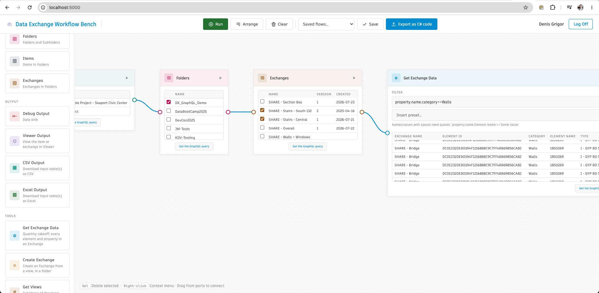

<!-- archived-notice -->
> **This repository is archived.** Archived repositories are not maintained or supported.

# Data Exchange Workflow Bench (.NET)

[](https://dotnet.microsoft.com/)
[](http://opensource.org/licenses/MIT)

## Description

This is the **ASP.NET Core** port of the Python sample (https://github.com/autodesk-platform-services/aps-dx-graphql-workflow-python) — the same visual dataflow editor using the APS Data Exchange GraphQL API, written as **learning material** with explicit structure and comments rather than minimal code.

The frontend (`wwwroot/`) is shared with the Python sample. The backend is reorganized into familiar ASP.NET Core layers: controllers, services, configuration, and node metadata.

For project layout, how to read the code, and node types, see [other_info.md](./other_info.md).

## Thumbnail



## Dependencies

- **[.NET SDK](https://dotnet.microsoft.com/download)** — this sample targets **.NET 9** (`net9.0`), matching [aps-medm-explorer](https://github.com/autodesk-platform-services/aps-medm-explorer) for Dokku compatibility.
- **APS account** — [create an app](https://aps.autodesk.com/myapps) with callback URL `http://localhost:8080/api/auth/callback`.

## Running locally

Data Exchange calls require a 3-legged token. Sign in through the browser; the session stores the token for all `/api/dx/*` routes.

### 1. Configure APS credentials

Edit `appsettings.Development.json` (same format as [aps-medm-explorer](https://github.com/autodesk-platform-services/aps-medm-explorer/blob/master/appsettings.Development.json)):

```json
{
  "APS_CLIENT_ID": "YOUR_APS_CLIENT_ID",
  "APS_CLIENT_SECRET": "YOUR_APS_CLIENT_SECRET",
  "APS_CALLBACK_URL": "http://localhost:8080/api/auth/callback",
  "AppSettings": {
    "AppUrl": "http://localhost:8080"
  }
}
```

You can also use environment variables: `APS_CLIENT_ID`, `APS_CLIENT_SECRET`, `APS_CALLBACK_URL`, or the nested `Aps__ClientId` style.

### 2. Restore and run

```bash
dotnet restore
dotnet run
```

### 3. Open the app

Visit [http://localhost:8080/](http://localhost:8080/). The landing page shows **Sign In with Autodesk** until you have a session; once signed in, the flow editor opens at `/`.

Preset reference workflows ship under `data/flows/` (same JSON as the Python sample).

## Deploying to Dokku

This repo follows the same flat layout as [aps-medm-explorer](https://github.com/autodesk-platform-services/aps-medm-explorer): a single `.csproj` at the repository root so the Autodesk Dokku .NET buildpack can detect and publish the app.

Set these config vars in Dokku Admin (or your platform's env settings):

| Variable | Example |
|----------|---------|
| `APS_CLIENT_ID` | your APS client id |
| `APS_CLIENT_SECRET` | your APS client secret |
| `APS_CALLBACK_URL` | `https://your-app.example.com/api/auth/callback` |
| `Aps__BehindProxy` | `true` |
| `Aps__SessionCookieSecure` | `true` |
| `FlowStorage__FlowsDirectory` | `/app/data/flows` (optional; defaults to `data/flows` relative to app root) |

Nested `Aps__ClientId` / `Aps__ClientSecret` / `Aps__RedirectUri` env vars also work if you prefer that style.

Register the same callback URL in your APS app settings. Do **not** commit secrets — use platform config vars only.

### OAuth sign-in troubleshooting

If Autodesk shows a `request-error` page after clicking **Sign In**:

1. **Register the production callback** in [APS My Apps](https://aps.autodesk.com/myapps) — it must match exactly:
   `https://<your-dokku-domain>/api/auth/callback`
2. **Set credentials in Dokku Admin** (Production does not use local-only env files unless deployed):
   - `APS_CLIENT_ID`
   - `APS_CLIENT_SECRET`
   - Optional: `APS_CALLBACK_URL` if auto-detection is not used
3. Check Dokku logs for `Starting APS OAuth login with redirect_uri=...` — that value must match your APS app callback list.

## How this maps to the Python sample

| Python | .NET |
|--------|------|
| `run.py` + `backend/__init__.py` | `Program.cs` |
| `config.py` | `Configuration/ApsOptions.cs` + `appsettings*.json` |
| `backend/routes/auth_routes.py` | `Controllers/OAuthController.cs` |
| `backend/routes/dx_routes.py` | `Controllers/DxController.cs` + `Services/DxApiService.cs` |
| `backend/routes/flow_routes.py` | `Controllers/FlowsController.cs` |
| `backend/services/*.py` | `Services/*.cs` |
| `backend/nodes/*.py` | `Nodes/NodeRegistry.cs` |
| `frontend/templates/*.html` | `Views/Home/*.cshtml` |
| `frontend/static/` | `wwwroot/` |

## Export as C# code

The toolbar **Export as C# code** button calls `POST /api/flows/export-script` and downloads a standalone script generated by `Services/FlowCodegenService.cs` — the .NET equivalent of the Python sample's `flow_codegen.py`.

## Known issues

- Access tokens are not auto-refreshed; sessions expire after ~1 hour.
- The exported C# script includes helper stubs — expand them for full headless parity (the web app itself is fully functional).

## Further reading

- [Detailed documentation](./other_info.md)
- [Python sample](../01.DX_Flow)
- [APS Data Exchange GraphQL tutorial](https://autodesk-platform-services.github.io/aps-dx-graphql-tutorial/)

## License

MIT — see [LICENSE](LICENSE) if present in the parent repo.
