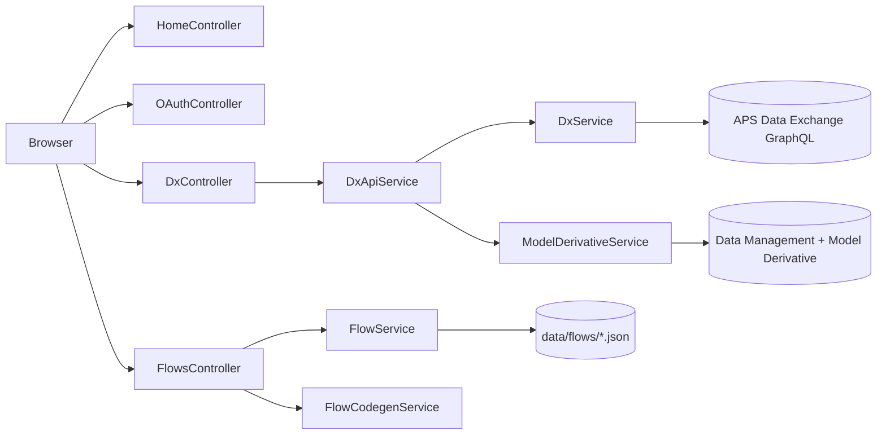

# Data Exchange Workflow Bench (.NET) — detailed guide

This document mirrors [other_info.md](../01.DX_Flow/other_info.md) from the Python sample, adapted for the ASP.NET Core project structure.

## Project layout

```
02.Dx_Flow_NET/
├── aps-dx-graphql-workflow-net.csproj   # Web app project (repo root — Dokku buildpack)
├── aps-dx-graphql-workflow-net.sln
├── data/flows/                # Saved flow JSON (includes reference presets)
├── README.md                  # Quick start
├── other_info.md              # This file
├── Program.cs                 # App startup — read this first after README
├── appsettings.json           # Default configuration
├── appsettings.Development.json  # Local secrets (ClientId/Secret)
├── Configuration/               # Strongly-typed settings classes
├── Constants/                 # Session key names
├── Controllers/               # HTTP endpoints (MVC + Web API)
├── Filters/                   # RequireAuthFilter for API routes
├── Models/                    # Flow JSON DTOs
├── Nodes/                     # Node type metadata (palette + GraphQL popups)
├── Services/                  # OAuth, GraphQL, flows, export, codegen
├── Views/Home/                # Landing + editor Razor pages
└── wwwroot/                   # Static JS/CSS (shared with Python sample)
```

## How to read this codebase

Start with these files in order:

1. **`Program.cs`** — registers services, session, static files, routing.
2. **`Controllers/OAuthController.cs`** — 3-legged OAuth flow (login → callback → session).
3. **`Controllers/HomeController.cs`** — landing page vs editor; injects node metadata JSON.
4. **`Nodes/NodeRegistry.cs`** — every node type's name, ports, connection rules, GraphQL help text.
5. **`Controllers/DxController.cs`** + **`Services/DxApiService.cs`** — one API route per node type.
6. **`wwwroot/js/core/run.js`** — frontend execution engine (unchanged from Python sample).
7. **`Services/FlowCodegenService.cs`** — export flow as standalone C# script.



## Node types

| Key | Name | Category | API |
|-----|------|----------|-----|
| `hubs` | Hubs | Navigation | GraphQL GetHubs |
| `projects` | Projects | Navigation | GraphQL GetProjects |
| `folders` | Folders | Navigation | GraphQL GetFolderContent (folders) |
| `items` | Items | Navigation | GraphQL GetFolderContent (items) |
| `exchanges` | Exchanges | Navigation | GraphQL GetFolderContent (exchanges) |
| `process` | Get Exchange Data | Tools | GraphQL FilterUsingComplexQuery |
| `logic` | Create Exchange | Tools | GraphQL createExchange mutation |
| `get_views` | Get Views | Tools | REST (Model Derivative metadata) |
| `filter` | Filter | Other | Client-side only |
| `output` | Debug Output | Output | Prints JSON |
| `data` | Viewer Output | Output | Autodesk Viewer in browser |
| `csv_output` | CSV Output | Output | POST `/api/dx/export/csv` |
| `excel_output` | Excel Output | Output | POST `/api/dx/export/excel` |

Each node type's **Get the GraphQL query** popup text lives in `NodeRegistry.cs` (where applicable).

## Reference workflows

Open these from the **Saved flows** dropdown after sign-in:

- `0dba775744a8.json` — Create Multiple Exchanges (Get Views → Create Exchange)
- `0dba775744a9.json` — Export Data From Multiple Exchanges (Get Exchange Data → CSV/Excel)

## Adding a node type

1. Add a `NodeTypeDefinition` property in `Nodes/NodeRegistry.cs`.
2. Add a JS handler in `wwwroot/js/nodes/` and register it in `registry.js`.
3. If the node calls APS, add a route in `DxController.cs` and logic in `DxApiService.cs`.
4. Optionally extend `FlowCodegenService.cs` for script export support.

## Configuration reference

| Setting | Environment variable | Description |
|---------|---------------------|-------------|
| `APS_CLIENT_ID` | `APS_CLIENT_ID` | APS app client id (shared with aps-medm-explorer) |
| `APS_CLIENT_SECRET` | `APS_CLIENT_SECRET` | APS app secret |
| `APS_CALLBACK_URL` | `APS_CALLBACK_URL` | OAuth callback (default `http://localhost:8080/api/auth/callback`) |
| `AppSettings:AppUrl` | `AppSettings__AppUrl` | Public app URL (default `http://localhost:8080`) |
| `Aps:ClientId` | `Aps__ClientId` | Alternative nested client id |
| `Aps:ClientSecret` | `Aps__ClientSecret` | Alternative nested secret |
| `Aps:RedirectUri` | `Aps__RedirectUri` | Alternative nested callback URL |
| `Aps:Scope` | `Aps__Scope` | OAuth scopes |
| `Aps:BehindProxy` | `Aps__BehindProxy` | Set `true` behind nginx/Dokku |
| `Aps:SessionCookieSecure` | `Aps__SessionCookieSecure` | Require HTTPS cookies in production |
| `FlowStorage:FlowsDirectory` | `FlowStorage__FlowsDirectory` | Where flow JSON is saved |

## Session keys

Stored in the ASP.NET session cookie (see `Constants/SessionKeys.cs`):

- `access_token` — APS bearer token for API calls
- `refresh_token` — stored but not auto-refreshed today
- `expires_in` — token lifetime for Viewer SDK
- `user_name` — display name in toolbar
- `oauth_states` — CSRF tokens for OAuth callback
